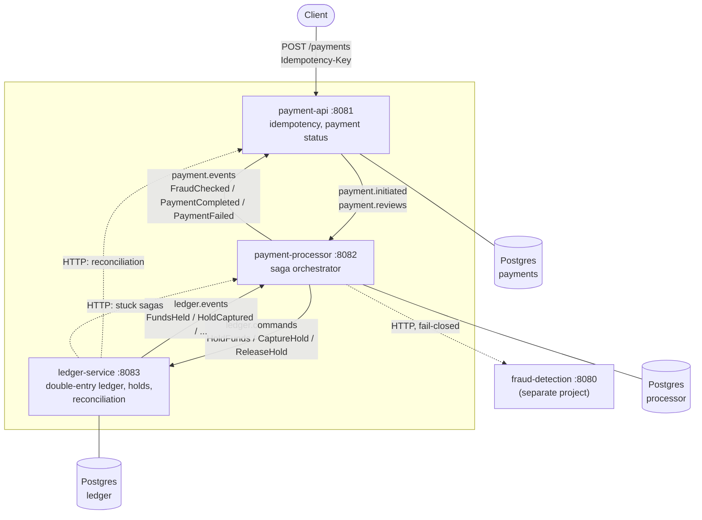
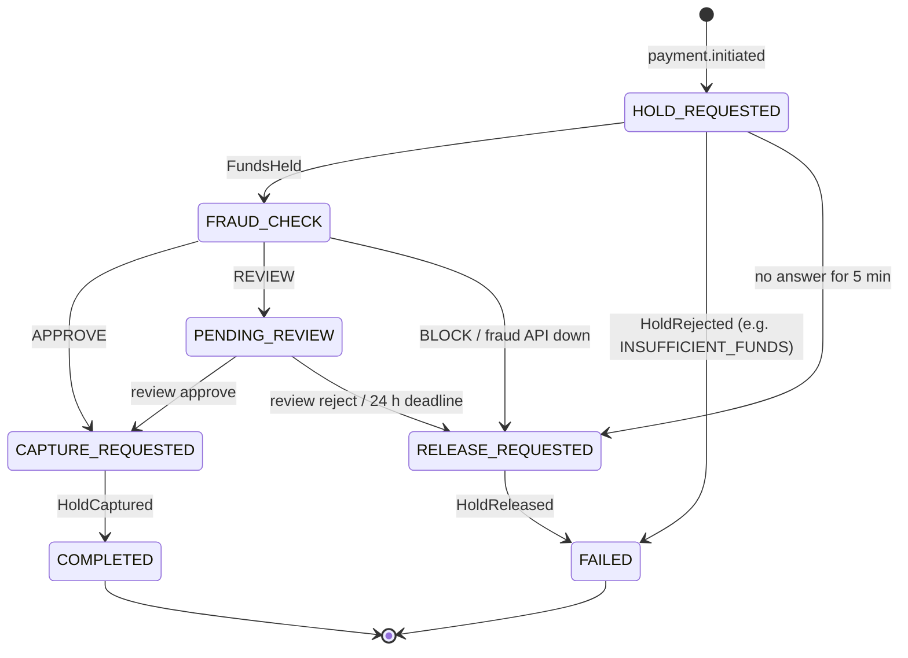

[](https://github.com/PerumallaSG2/event-driven-payment-platform/actions/workflows/ci.yml)

# Event-Driven Payment Platform

Three Spring Boot services take card payments to merchants and move the money between ledger accounts
**effectively once**, even though Kafka only promises at-least-once delivery. They do it with a double-entry
ledger, a transactional outbox/inbox, an orchestrated saga with compensation, and a fail-closed check against a
real, separate [fraud-detection](https://github.com/PerumallaSG2/fraud-detection) service. **155 tests**
back this up, including 15 fault-injection scenarios that kill real processes and pause Kafka. Every scenario
ends with a clean reconciliation.

**At a glance**

- **Stack:** Java 21, Spring Boot 4, Kafka 3.9 (KRaft), PostgreSQL 16, Flyway, Testcontainers 2, GitHub Actions
- **Designed so money is never created, lost or moved twice:** double-entry postings sum to zero, and holds keep the
  payer's money out of reach until the payment settles
- **Proven under failure:** SIGKILL and `Runtime.halt` at each step of the saga, duplicated messages on every
  topic, a paused broker, and a fraud API that is down or hangs
- **Checked independently:** a reconciliation job compares each service's view of every payment
- **Run against the real fraud app:** see the [manual end-to-end run](docs/manual-run.md)

## Architecture



Arrows labeled with topic names are Kafka, written through each service's outbox. Each service owns its own database, and no
service reads another's tables. Failed records go to `<topic>.DLT`.

**The saga** (payment-processor):



## How each payment moves money only once

| Mechanism | What it guarantees |
|---|---|
| **Double-entry ledger** | Every journal entry's postings sum to zero per currency (`NUMERIC(19,2)`, `BigDecimal`), enforced by a deferred DB constraint. Balances can't go negative unless the account allows it, so concurrent debits can't overdraw. |
| **Holds** | Authorizing moves money from the payer to a per-currency HOLDS account. Capturing moves it to the merchant, and releasing moves it back to the payer. At any moment the money is in exactly one place. |
| **Idempotency keys** | `POST /payments` with the same key and body replays the first answer, a different body gets 422, and a request still in flight gets 409. Keys are kept for 24 h. |
| **Transactional outbox** | No service writes to its DB and sends to Kafka in the same method. Events go into an `outbox` table in the business transaction, and a relay (`FOR UPDATE SKIP LOCKED`, idempotent producer) publishes them. A crash can delay an event but never lose it. |
| **Inbox** | Every consumer records the event id in the same transaction as its work and skips duplicates. Ledger commands are also idempotent by payment id. Bad records go to a DLT after 3 attempts. |
| **Orchestrated saga** | payment-processor drives each payment through hold → fraud check → capture or release. A sweep re-sends commands that got no answer for 30 s and releases holds still missing after 5 min. A requested capture is never compensated, only re-sent. |
| **Fail-closed fraud check** | APPROVE captures, BLOCK releases, and REVIEW keeps the hold until `POST /payments/{id}/review`. If the fraud API is down, slow or returns something malformed, the hold is released and the payment fails with `FRAUD_UNAVAILABLE`. A timed-out POST is never re-sent. |
| **Reconciliation** | Every 15 min, or on `POST /reconciliation/runs`, ledger-service checks its own tables (zero-sum entries, balance = sum of postings, HOLDS = open holds). It then compares every final payment in payment-api with the ledger and asks payment-processor for stuck sagas. It reports and never fixes. |

## Results

### Tests (`./mvnw test`, all on Testcontainers, no mocks of Postgres or Kafka)

| Module | Tests | What they cover |
|---|---:|---|
| ledger-service | 50 | postings, deferred zero-sum constraint, concurrent debits, holds, Kafka commands, reconciliation |
| payment-api | 44 | idempotency (replay / 422 / 409), outbox, payment events, review, reconciliation endpoint |
| payment-processor | 46 | saga and compensation, stuck-saga sweep, fraud client (retries, timeouts, malformed answers) |
| e2e-tests | 15 | fault injection: the 3 services as real processes on one Postgres and one Kafka |
| **Total** | **155** | 0 skipped. CI fails if any test is skipped. |

### Fault injection (`services/e2e-tests`)

| # | Fault | Outcome |
|---|---|---|
| 1 | 10 concurrent requests with one idempotency key, then replays | 1 payment, 1 hold, 1 fraud call; a different body gets 422 |
| 2 | Every message on every topic delivered twice | Each payment moves money once |
| 3 | 20 concurrent 10.00 payments from a 100.00 account | 10 COMPLETED, 10 FAILED (`INSUFFICIENT_FUNDS`), balance 0.00 |
| 4 | Fraud API down | FAILED (`FRAUD_UNAVAILABLE`), hold released |
| 5 | Fraud API slow | FAILED (`FRAUD_UNAVAILABLE`), asked only once |
| 6–7 | Fraud says REVIEW, then approve / reject | Money waits in HOLDS, then COMPLETED / FAILED (`FRAUD_REJECTED`) |
| 8 | Fraud says BLOCK | FAILED (`FRAUD_BLOCKED`), hold released |
| 9 | Kafka paused for 15 s mid-flow | Payments wait in the outboxes, then all complete |
| 10 | payment-api halts before publishing the payment | The outbox publishes it after restart, and the payment completes |
| 11 | ledger halts after the hold commits, before `FundsHeld` | Completes after restart, with one fraud call |
| 12 | payment-processor SIGKILLed mid fraud check | The stale check fails closed after restart, and fraud isn't asked again |
| 13 | payment-processor halts on receiving `FundsHeld` | Redelivered after restart; completes |
| 14 | ledger halts after the capture, before `HoldCaptured` | Completes after restart, with one capture |
| 15 | payment-processor halts after COMPLETED, before publishing it | The outbox publishes it after restart, and payment-api shows COMPLETED |

Every scenario ends with no OPEN holds, a HOLDS balance of 0.00, empty DLTs and a **CLEAN** reconciliation.

### Manual run against the real fraud-detection app

Both projects ran side by side on one 8 GB MacBook, with each payment driven by `curl`
([details](docs/manual-run.md)).

| # | Payment | Fraud decision | Saga outcome | Payer / merchant after | Hold | Reconciliation |
|---|---|---|---|---|---|---|
| 1 | 10.50, RESTAURANT, 13:15 local | APPROVE, score 0 | **COMPLETED** | 89.50 / 10.50 | CAPTURED | CLEAN |
| 2 | 25.00, GAMBLING, 02:30 local | REVIEW, score 50 (RISKY_MERCHANT + ODD_HOURS) | **PENDING_REVIEW** → approve → **COMPLETED** | 75.00 / 25.00 | OPEN → CAPTURED | CLEAN |
| 3 | 25.00, GAMBLING, 02:30 local | REVIEW, score 50 | **PENDING_REVIEW** → reject → **FAILED (FRAUD_REJECTED)** | 100.00 / 0.00 | OPEN → RELEASED | CLEAN |
| 4 | 10.50, fraud app stopped | none (connection refused) | **FAILED (FRAUD_UNAVAILABLE)** in about 1 s | 100.00 / 0.00 | RELEASED | CLEAN |

## Run it locally

You need Java 21 and Docker. The host ports don't clash with fraud-detection, so both can run at once.

| | This platform | fraud-detection |
|---|---|---|
| Postgres | 5434 | 5433 |
| Kafka | 9095 | 9094 |
| Apps | 8081 (api), 8082 (processor), 8083 (ledger), kafka-ui 8085 | 8080 |

```bash
./mvnw test                                                   # everything, about 4 min (needs Docker)

docker compose -f infra/docker-compose.yml up -d --wait       # Postgres + Kafka (+ kafka-ui)
./mvnw -pl services/ledger-service spring-boot:run            # in three terminals
./mvnw -pl services/payment-api spring-boot:run
./mvnw -pl services/payment-processor spring-boot:run
```

**Without the fraud app**, the platform runs, but every payment ends `FAILED (FRAUD_UNAVAILABLE)` with the hold
released. That's the fail-closed policy working, not a bug.

**With the fraud app**, start [fraud-detection](https://github.com/PerumallaSG2/fraud-detection) first. Run its
`docker compose up -d --wait`, then run its jar on :8080. The processor's default `FRAUD_URL` is
`http://localhost:8080`. On an 8 GB machine, run each service from its jar with `-Xmx256m -XX:+UseSerialGC`
([manual run](docs/manual-run.md)).

Then try a payment:

(Needs jq: `brew install jq`)

```bash
PAYER=$(curl -s -X POST localhost:8083/accounts -H 'Content-Type: application/json' \
  -d '{"name":"alice","kind":"CUSTOMER","currency":"USD"}' | jq -r .id)
SHOP=$(curl -s -X POST localhost:8083/accounts -H 'Content-Type: application/json' \
  -d '{"name":"corner-coffee","kind":"MERCHANT","currency":"USD"}' | jq -r .id)
curl -s -X POST localhost:8083/accounts/$PAYER/deposits -H 'Content-Type: application/json' -d '{"amount":100.00}'

curl -s -X POST localhost:8081/payments -H 'Content-Type: application/json' -H "Idempotency-Key: $(uuidgen)" \
  -d "{\"payerAccountId\":\"$PAYER\",\"merchantAccountId\":\"$SHOP\",\"amount\":10.50,\"currency\":\"USD\",
       \"cardId\":\"card-1\",\"merchant\":\"Corner Coffee\",\"merchantCategory\":\"RESTAURANT\",\"city\":\"Austin\",
       \"latitude\":30.2672,\"longitude\":-97.7431,\"timestamp\":\"2026-03-14T13:15:00-05:00\"}"
curl -s localhost:8081/payments/<paymentId>                   # status, fraud decision
curl -s -X POST localhost:8081/payments/<paymentId>/review -H 'Content-Type: application/json' -d '{"decision":"approve"}'
curl -s -X POST localhost:8083/reconciliation/runs            # CLEAN / MISMATCHES / INCOMPLETE

docker compose -f infra/docker-compose.yml down               # add -v to wipe the data
```

## Design trade-offs and known limits

- **Orchestration over choreography.** One service owns each payment's state, which makes stuck payments
  visible and compensation explicit. The cost is one more service on the hot path.
- **Fail closed.** If fraud-detection is down, every payment fails. It's safer for money, worse for availability.
  Its API takes no idempotency key, so a POST that timed out is never retried (that could score the payment twice).
- **Effectively once, not exactly once.** Delivery stays at-least-once, and duplicates are absorbed by inbox
  tables and idempotent ledger commands. Events can be delayed by up to a relay or sweep interval.
- **Reconciliation detects, it doesn't repair.** Fixing money automatically is a decision for a person.
- **Funds stay held during review**, for up to 24 h, then the payment fails with `REVIEW_TIMEOUT`.
- **Scope:** one currency per payment (no FX), no refunds or partial captures, no authentication or TLS, one
  Kafka broker and one Postgres in dev, and no metrics endpoint (actuator was left out to keep dependencies small).

## Future work

- Refunds, partial captures and chargebacks
- Metrics and tracing (Micrometer, OpenTelemetry) across the saga
- Authentication between client, services and fraud API
- A multi-broker Kafka setup with tuned partitioning per payment id
- An idempotency key on the fraud API, so timed-out checks can be retried safely

## Project layout

```
services/payment-api         client API, idempotency, payment status
services/payment-processor   saga orchestrator, fraud client, stuck-saga sweep
services/ledger-service      accounts, postings, holds, reconciliation
services/e2e-tests           fault-injection tests (real processes, real infra)
infra/docker-compose.yml     Postgres 16, Kafka 3.9 (KRaft), kafka-ui
```
